 
 

 
 

<picture>
  <source media="(prefers-color-scheme: dark)" srcset="https://raw.githubusercontent.com/kaito5757/kaito5757/output/dog-dark.svg">
  <source media="(prefers-color-scheme: light)" srcset="https://raw.githubusercontent.com/kaito5757/kaito5757/output/dog-light.svg">
  
</picture>

 
 

